# Team Chat Application: Architecture Specifications

Date: 2026-11-11
Sources: [chatapp.assumptions.md](./chatapp.assumptions.md), [chatapp.requirements.md](./chatapp.requirements.md), [chatapp.funcspecs.md](./chatapp.funcspecs.md)

> **Status at a glance**
> A layered Python service with a built-in real-time channel and an embedded database. It starts with two commands and no installed server software. It is built so each lab shortcut has a named production replacement on Azure (section 11). Design decisions are numbered DD-01 and up, and each one names the requirement or assumption it comes from.

## Contents

1. [Technology stack](#1-technology-stack)
2. [Architecture overview](#2-architecture-overview)
3. [Logical block diagram](#3-logical-block-diagram)
4. [Components (CRC)](#4-components-crc)
5. [Data models](#5-data-models)
6. [API specifications](#6-api-specifications)
7. [Real-time protocol](#7-real-time-protocol)
8. [Sequence diagrams](#8-sequence-diagrams)
9. [Meeting the Fundamentals](#9-meeting-the-fundamentals)
10. [Cross-cutting concerns](#10-cross-cutting-concerns)
11. [Architectural risks and lab shortcuts](#11-architectural-risks-and-lab-shortcuts)

---

## 1. Technology stack

| Area | Choice | Justification | Trace |
| --- | --- | --- | --- |
| Language and framework | Python 3.12 with FastAPI (on Starlette) and Uvicorn | The owner chose Python. FastAPI gives asynchronous request handling, built-in WebSocket support, input validation with typed models, and an automatic API description. It runs with `pip install` and one command. It runs on Azure App Service for Linux or Azure Container Apps without change. | A-09, A-10, NFR-04 |
| Real-time messaging | Native WebSocket served by the same process, with an in-process connection hub | Instant push needs a persistent connection. A WebSocket needs no extra service to run locally. The hub keeps one outgoing queue per connection so a slow client cannot delay others. In production this role moves to a managed service (section 11). | A-10, FR-40, SLO-02 |
| Data storage | SQLite (Python standard library `sqlite3`), write-ahead log mode, full synchronous writes, FTS5 full-text search | Zero setup: one file, no server. Full synchronous writes mean a message is on disk before it is acknowledged. FTS5 gives search without another component. Transactions give a safe, gap-free message order per conversation. | A-11, A-27, FR-25, FR-41, FR-43, NFR-02 |
| File storage | Local folder with generated file names | No setup. Names never come from the user, so a file name cannot point outside the folder. In production: Azure Blob Storage. | A-23, FR-24 |
| Web client | Plain HTML, CSS, and JavaScript served by the same service. No build step. | Nothing to install. Small enough to review for accessibility and script injection. | A-09, A-24, FR-21 |
| Sign-in (lab) | Development sign-in issuing an HMAC-signed token with an 8-hour life | Stands in for Entra ID so the lab runs offline. It is isolated behind one interface so Entra ID replaces it without changing the rest. | A-03, FR-01, SEC-09 |
| Observability | JSON logs to standard output, a correlation ID on every request, in-process metrics, and an SLO tracker that stores per-minute counts in the database | Gives the monitoring the assumptions ask for with no setup. In production: OpenTelemetry into Azure Monitor and Application Insights (section 11). | A-33, OPS-01, SLO-03 |
| Testing | pytest with FastAPI's test client | Tests run the real service in memory with a temporary database. | A-14, NFR-06 |

Local run needs only Python and `pip`. There is no database server, message broker, or container.

## 2. Architecture overview

### Structure

The service is one deployable unit (a modular monolith) with four layers:

1. **Transport layer:** HTTP routes and one WebSocket endpoint. It checks input shape, calls the sign-in check, and turns errors into responses.
2. **Service layer:** the rules of the product (membership, ordering, deletion, search, notifications, limits). It knows nothing about HTTP.
3. **Data layer:** one `Database` object that owns the SQLite connection and the schema.
4. **Real-time layer:** the connection hub, which takes events from services and delivers them to open connections.

Cross-cutting parts (middleware, configuration, logging, rate limit, SLO tracker, audit log) sit beside the layers.

### Patterns used

| Pattern | Where | Why |
| --- | --- | --- |
| Layered architecture | Routers, services, database | Keeps rules testable without HTTP. Maps cleanly onto a production move to other storage. |
| Server-assigned sequence | Per-conversation message number, assigned inside the write transaction | Gives one order for every device (FR-41) without clocks. |
| Idempotent command | Client-created message ID with a unique database constraint | Safe retries with no duplicates (FR-42). |
| Write, then publish | A message is committed first, then handed to the hub | Nothing is shown as sent that is not stored (FR-43). |
| Per-connection queue | Hub | A slow or stuck client cannot block delivery to others, and a full queue closes that connection so the client resumes cleanly (NFR-07). |
| Resume by cursor | The client reports the last number it holds per conversation | Bounded, ordered catch-up with no gaps (FR-45). |
| Membership periods | Table of from/to sequence ranges per member | Answers "who may see which message" with one rule, including re-adds (FR-15). |
| Tombstone | A deleted message keeps its row with no content | Keeps order and thread structure while removing content (FR-27, FR-29). |
| Port-style seams | Token service, attachment scanner, notification outbox | Each lab stand-in can be replaced by a production service without touching callers (section 11). |

### Key design decisions

| ID | Decision | Rationale | Trace |
| --- | --- | --- | --- |
| DD-01 | One process, one SQLite file, one event loop. Database calls are short and run on the event loop. | Meets the 10-user load (A-28) with the least moving parts. A single writer makes the message order trivially safe. The cost is no scaling out, which is a stated lab shortcut (R-01). | A-28, NFR-04 |
| DD-02 | Messages are sent with HTTP POST, and pushed with the WebSocket. | A POST has a clear success or failure, which supports retry, idempotency, the delivery status the user sees, and the Success Rate SLO. The WebSocket carries only server-to-client events and small client messages (resume, ack). | FR-42, FR-44, SLO-01 |
| DD-03 | Message order is a per-conversation integer assigned in the same transaction that stores the message. | One order for everyone, with no dependence on device clocks. | FR-41, A-13 |
| DD-04 | The unique pair (sender, client message ID) makes a retry return the stored message. | Retries never duplicate. | FR-42, A-13 |
| DD-05 | The service acknowledges a POST only after the transaction commits with full synchronous writes. | An acknowledged message survives a restart (recovery point of zero on one machine). | FR-43, NFR-02, A-27 |
| DD-06 | The hub looks up current members at publish time. It does not cache membership. | Removing a member takes effect on the next event with no cache to invalidate. | FR-14, SEC-03 |
| DD-07 | Every request and every WebSocket connection loads the user and checks that they are active. Deactivation also closes that user's connections. | Immediate access removal even with a signed token that has not expired. | FR-04, SEC-09, A-30 |
| DD-08 | Authorization is a membership check in the service layer, and "not a member" and "does not exist" give the same answer (404). | Cannot probe for conversations. The rule lives in one place. | SEC-03, FR-16 |
| DD-09 | The administration API has no endpoint that returns message content. | Administrators and operators have no routine access to content. | SEC-04, A-22 |
| DD-10 | Message text is stored as typed. The client renders it with escaping first, then a small set of markdown rules. The service sets a strict content security policy. | No stored markup, so a rendering fix needs no data migration. Two layers against script injection. | FR-21, SEC-08, A-23 |
| DD-11 | Deleting a message sets its text to empty, removes its attachments' files, removes mentions, and updates the search index in the same transaction. | Deletion reaches every copy that the service controls at once. | FR-27, FR-28, PRV-02, A-17 |
| DD-12 | Catch-up returns messages after the client's cursor, and also the IDs of messages deleted since the client's last sync time. | A message deleted while a client was offline disappears when the client returns. | FR-45, FR-27 |
| DD-13 | Delivery latency is measured by the recipient's confirmation of each message, and unconfirmed deliveries after 10 seconds are counted in the slowest bucket. | The measurement matches the SLO definition and cannot hide slow or lost deliveries. | SLO-02, A-29 |
| DD-14 | The Success Rate counts only customer API calls. Health, metrics, objectives, and static files are excluded. Client errors (4xx) are not counted. | Matches the SLO definition, which excludes client errors. | SLO-01 |
| DD-15 | SLO counts are kept per minute in memory and saved to the database at least once a minute and at shutdown. | The 28-day window survives a restart. | SLO-01, SLO-02, SLO-03 |
| DD-16 | The service reports "insufficient data" for any window below the minimum sample size. | No false breach or false pass. | SLO-05 |
| DD-17 | Configuration comes from environment variables with safe defaults. | One build for every environment. Production values come from the platform. | NFR-08, A-25 |
| DD-18 | The retention period is a setting. A scheduled job removes message content older than the limit. By default it does nothing. | "Keep forever" is only a placeholder, so the design must not assume it. | NFR-05, A-16 |
| DD-19 | All administrative and membership changes write an audit record in the same transaction as the change. | The audit trail cannot disagree with the data. | SEC-05, A-22 |
| DD-20 | Errors use one response shape with a stable code, a plain message, and the request's correlation ID. | One thing for the client to handle. Support can trace a failure. | OPS-05, A-33 |
| DD-21 | Logs contain request metadata only. A filter rejects fields named like message content. | Keeps sensitive text out of logs. | PRV-03, A-33 |
| DD-22 | Attachments are uploaded first, then referenced by ID when sending. They pass through a scanner interface before they can be opened. | Keeps the message send small and fast, lets uploads fail and retry on their own, and gives one place for the scan. | FR-24, A-23 |
| DD-23 | The client uses paging of 50 and never asks for "everything". | Bounds catch-up work however long the absence. | NFR-07, A-31 |
| DD-24 | Email and push notifications go into an outbox table with no message text. The lab never sends them. | The privacy rule holds from the start, and a real sender can be added behind the outbox. | FR-26, A-20 |

## 3. Logical block diagram

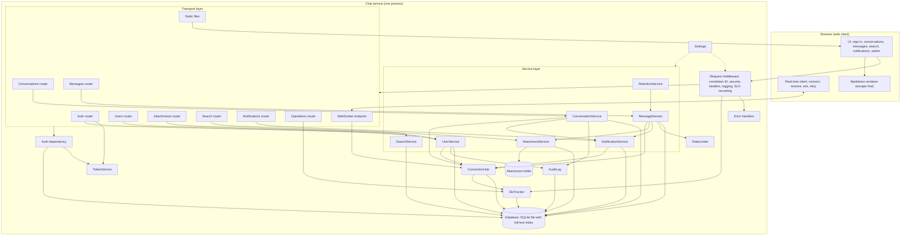

## 4. Components (CRC)

| Component | Responsibilities | Collaborators |
| --- | --- | --- |
| **Settings** | Reads configuration from environment variables with defaults. Provides limits (message length, rate, file size, page size, session hours, timeouts). | All components |
| **Database** | Opens the SQLite file with write-ahead logging and full synchronous writes. Creates the schema and the full-text index on first start. Provides a transaction helper. Reports file size and health. | Services, Hub, AuditLog, SloTracker |
| **TokenService** | Creates and verifies signed session tokens with an expiry. Holds the signing key (generated once and stored beside the database in the lab). | Auth router, AuthDependency, WebSocket endpoint |
| **AuthDependency** | Reads the token from the request, verifies it, loads the user, rejects deactivated or unknown users, and supplies the current user. Provides the administrator check. | TokenService, Database, every router |
| **RequestMiddleware** | Assigns the correlation ID. Adds security headers. Times each request. Writes one log line. Reports the outcome of each customer API call to the SloTracker. Turns a timeout or crash into a failed count. | SloTracker, logging, ErrorHandlers |
| **ErrorHandlers** | Maps application errors, validation errors, and unexpected failures to the single error response shape. Never exposes internal details. | RequestMiddleware |
| **UserService** | Creates users, lists users, grants and removes the administrator role, deactivates users (and closes their connections). Enforces the two-administrator minimum. Seeds the first administrators. | Database, AuditLog, ConnectionHub |
| **ConversationService** | Creates direct, group, and channel conversations. Adds and removes members and maintains membership periods. Enforces member limits and who may do what. Lists conversations with unread counts. Tracks read position. | Database, AuditLog, NotificationService, ConnectionHub |
| **MessageService** | Checks membership and rate limit. Assigns the sequence number and stores the message in one transaction. Handles duplicates by client ID. Parses mentions. Stores replies. Deletes messages (tombstone). Pages history (before, after, around). Builds the thread view. Publishes events. | Database, RateLimiter, AttachmentService, NotificationService, ConnectionHub |
| **AttachmentService** | Validates size and type. Stores the file under a generated name. Calls the scanner. Checks membership before download. Links uploads to messages. Removes unsent uploads after an hour and removes files of deleted messages. | Database, attachment folder |
| **SearchService** | Turns user text into a safe full-text query. Returns matches restricted to the user's visible history, newest first. | Database |
| **NotificationService** | Creates mention and "added" notifications. Queues email entries in the outbox for users with no open connection. Lists notifications and marks them read. Pushes live notification events. | Database, ConnectionHub |
| **ConnectionHub** | Tracks open WebSocket connections per user. Gives each connection a bounded queue and a writer task. Publishes events to the current members. Handles resume (replay by cursor, deleted IDs). Records delivery confirmations. Closes connections for deactivated users and expired sessions. | Database, SloTracker, services |
| **RateLimiter** | Counts messages per user in a sliding 60-second window and says whether another is allowed. | MessageService |
| **SloTracker** | Records customer request outcomes and delivery latencies in one-minute buckets. Saves the buckets. Computes the Success Rate and latency percentiles for 1-hour, 24-hour, and 28-day windows. Applies the minimum sample rule and the burn-rate warning. | Database, RequestMiddleware, ConnectionHub, Operations router |
| **AuditLog** | Writes who did what to what, with the time, in the caller's transaction. | Database, UserService, ConversationService |
| **RetentionService** | When a retention period is set, removes content of messages older than the period, using the same deletion path as a user deletion. | MessageService, Database |
| **Routers (transport)** | Define the endpoints in section 6. Check input shape. Call services. Return the response. | Services, AuthDependency |
| **Web client** | Draws the interface. Opens the WebSocket. Sends messages with retry. Resumes after a drop. Renders messages safely. Announces new messages to screen readers. | Routers, WebSocket endpoint |

## 5. Data models

Types are SQLite types. All IDs are random 32-character hexadecimal strings. All times are UTC text in ISO 8601 form.

### users

| Field | Type | Description |
| --- | --- | --- |
| id | TEXT, primary key | User ID |
| username | TEXT, unique | Lowercase sign-in name, 3 to 32 characters |
| display_name | TEXT | Name shown to others |
| is_admin | INTEGER | 1 for administrators |
| status | TEXT | `active` or `deactivated` |
| created_at | TEXT | Creation time |
| deactivated_at | TEXT, null | Deactivation time |

### conversations

| Field | Type | Description |
| --- | --- | --- |
| id | TEXT, primary key | Conversation ID |
| type | TEXT | `dm`, `group`, or `channel` |
| name | TEXT, null | Name for groups and channels. Null for direct messages. |
| name_key | TEXT, null | Lowercase name. Unique among channels. |
| dm_key | TEXT, null | The two user IDs joined in sorted order. Unique. Makes one direct conversation per pair. |
| created_by | TEXT | User ID of the creator |
| created_at | TEXT | Creation time |
| last_seq | INTEGER | The highest message number assigned so far |

### memberships

One row per period of membership, so a person who leaves and returns has two rows.

| Field | Type | Description |
| --- | --- | --- |
| id | INTEGER, primary key | Row ID |
| conversation_id | TEXT | Conversation |
| user_id | TEXT | Member |
| from_seq | INTEGER | First message number the member may see in this period |
| to_seq | INTEGER, null | Last message number the member may see. Null while still a member. |
| joined_at | TEXT | When the period began |
| left_at | TEXT, null | When the period ended |

A member is current when `to_seq` is null. A message with number `n` is visible to a user when some row has `from_seq <= n` and (`to_seq` is null or `n <= to_seq`).

### messages

| Field | Type | Description |
| --- | --- | --- |
| id | TEXT, primary key | Message ID |
| conversation_id | TEXT | Conversation |
| seq | INTEGER | Order within the conversation. Unique together with the conversation. |
| sender_id | TEXT | Author |
| client_msg_id | TEXT | The sender's unique ID for retries. Unique together with the sender. A repeat of the same ID for a different conversation is refused with a conflict. |
| body | TEXT, null | Message text as typed. Null after deletion. |
| reply_to_id | TEXT, null | The original message of a thread |
| created_at | TEXT | Server receive time |
| deleted_at | TEXT, null | Deletion time |

### messages_fts

A full-text index over `messages.body`, kept in step by database triggers. A deleted message leaves the index in the same transaction.

### mentions

| Field | Type | Description |
| --- | --- | --- |
| message_id | TEXT | Message |
| user_id | TEXT | Mentioned member |

Primary key is both fields.

### attachments

| Field | Type | Description |
| --- | --- | --- |
| id | TEXT, primary key | Attachment ID |
| conversation_id | TEXT | Conversation it was uploaded to |
| uploader_id | TEXT | Uploader |
| message_id | TEXT, null | The message it is attached to. Null until sent. |
| filename | TEXT | Original file name, for display only |
| content_type | TEXT | Checked type |
| size_bytes | INTEGER | Size |
| storage_name | TEXT | Generated file name on disk |
| scan_status | TEXT | `clean`, `pending`, or `rejected` |
| created_at | TEXT | Upload time |
| deleted_at | TEXT, null | Removal time |

### notifications

| Field | Type | Description |
| --- | --- | --- |
| id | TEXT, primary key | Notification ID |
| user_id | TEXT | Recipient |
| type | TEXT | `mention` or `added` |
| conversation_id | TEXT | Conversation |
| actor_id | TEXT | The person who caused it |
| message_id | TEXT, null | The message for a mention |
| created_at | TEXT | Time |
| read_at | TEXT, null | When read |

No message text is stored here (FR-26).

### notification_outbox

| Field | Type | Description |
| --- | --- | --- |
| id | TEXT, primary key | Entry ID |
| user_id | TEXT | Recipient |
| channel | TEXT | `email` (push is designed, not built) |
| type | TEXT | `mention` or `added` |
| conversation_id | TEXT | Conversation |
| actor_id | TEXT | The person who caused it |
| created_at | TEXT | Queued time |
| sent_at | TEXT, null | Always null in the lab |

### read_cursors

| Field | Type | Description |
| --- | --- | --- |
| user_id | TEXT | User |
| conversation_id | TEXT | Conversation |
| last_read_seq | INTEGER | Highest message number the user has read |

Primary key is both fields. Unread count is the number of visible, non-deleted messages from others above this number.

### audit_log

| Field | Type | Description |
| --- | --- | --- |
| id | INTEGER, primary key | Row ID |
| ts | TEXT | Time |
| actor_id | TEXT | Who did it |
| action | TEXT | For example `user.create`, `user.deactivate`, `member.add`, `member.remove`, `channel.create` |
| target_type | TEXT | `user` or `conversation` |
| target_id | TEXT | Target ID |
| detail | TEXT | Small JSON note with no message content |

### slo_minutes

| Field | Type | Description |
| --- | --- | --- |
| minute | TEXT, primary key | UTC minute |
| req_total | INTEGER | Counted customer requests |
| req_failed | INTEGER | Failed requests |
| lat_counts | TEXT | JSON list of counts per latency bucket |
| lat_total | INTEGER | Total latency samples |

Latency bucket upper edges in milliseconds: 10, 25, 50, 100, 150, 200, 300, 400, 500, 700, 1000, 1500, 2000, 3000, 5000, 10000, and one overflow bucket. The target values (200, 400, 700, 1000, 2000) are all bucket edges, so a comparison against a target is exact.

### Wire shapes (shared by the API and WebSocket)

| Shape | Fields |
| --- | --- |
| User | `id`, `username`, `display_name`, `is_admin`, `status` |
| Conversation | `id`, `type`, `name`, `members` (list of `id`, `display_name`, `status`), `last_seq`, `unread_count`, `created_at` |
| Message | `id`, `conversation_id`, `seq`, `sender_id`, `sender_name`, `sender_status`, `body` (null if deleted), `deleted`, `reply_to_id`, `mentions` (user IDs), `attachments` (list of Attachment), `client_msg_id`, `created_at` |
| Attachment | `id`, `filename`, `content_type`, `size_bytes` |
| Notification | `id`, `type`, `conversation_id`, `conversation_name`, `actor_id`, `actor_name`, `message_id`, `created_at`, `read` |
| Error | `error` with `code`, `message`, `request_id` |

## 6. API specifications

All routes are under `/api/v1` unless marked. All requests and responses use JSON, except file upload and download. Every response carries the header `X-Request-ID`. Every route except the ones marked "Open" needs the header `Authorization: Bearer <token>`. Error responses use the Error shape. Common errors: 401 `unauthorized` (missing, invalid, or expired token, or deactivated user), 429 `rate_limited`, 500 `internal_error`.

### Operations

| Route | Method | Auth | Request | Response | Constraints and errors |
| --- | --- | --- | --- | --- | --- |
| `/healthz` | GET | Open | none | 200 `{"status":"ok"}` | Liveness only. Not counted in the SLO. (OPS-01) |
| `/readyz` | GET | Open | none | 200 `{"status":"ready"}` | 503 `{"status":"not_ready"}` if the database cannot be reached. Not counted. |
| `/metrics` | GET | Administrator | none | 200 object: `uptime_seconds`, `http` (`requests_total`, `by_status`), `websocket` (`connections`, `deliveries_confirmed`, `deliveries_timed_out`), `storage` (`database_bytes`, `attachment_bytes`, `messages_total`) | 403 `forbidden` for non-administrators. (OPS-01, F-06) |
| `/api/v1/slo` | GET | Administrator | Query `window` (optional): `1h`, `24h`, or `28d` | 200 `{"targets":{...},"windows":{"1h":{...},"24h":{...},"28d":{...}},"burn_rate_warning":false}`. Each window has `success_rate` (`requests`, `failed`, `value`, `target`, `status`) and `latency_ms` (`samples`, and for each of `p50`, `p75`, `p90`, `p95`, `p99`: `value_ms`, `target_ms`, `status`). `status` is `ok`, `breach`, or `insufficient_data`. | 400 for an unknown window. (SLO-03, SLO-04, SLO-05) |

### Auth and users

| Route | Method | Auth | Request | Response | Constraints and errors |
| --- | --- | --- | --- | --- | --- |
| `/api/v1/auth/dev-login` | POST | Open | `{"username": string}` | 200 `{"token": string, "expires_at": time, "user": User}` | Lab only, switched off by setting. 404 when disabled. 401 `unauthorized` with the same text for unknown and deactivated users. (FR-01, SEC-09) |
| `/api/v1/me` | GET | Member | none | 200 User | (UC-01) |
| `/api/v1/users` | GET | Member | none | 200 `{"users":[User]}` | Includes deactivated users so past messages can show "former member". Contains no message content. (FR-05) |
| `/api/v1/users` | POST | Administrator | `{"username": string, "display_name": string, "is_admin": boolean (optional)}` | 201 User | `username` matches `^[a-z0-9._-]{3,32}$`. `display_name` 1 to 60 characters. 400 invalid. 409 `conflict` if the name exists. 403 non-administrator. Writes an audit record. (FR-03, UC-16) |
| `/api/v1/users/{user_id}` | PATCH | Administrator | `{"is_admin": boolean}` | 200 User | 404 unknown user. 409 `conflict` if the change leaves fewer than two active administrators. Writes an audit record. (FR-03) |
| `/api/v1/users/{user_id}/deactivate` | POST | Administrator | none | 200 User | 404 unknown. 409 `conflict` if it is the caller or would leave fewer than two active administrators. Closes the user's connections, removes them from group chats and channels, writes an audit record. Idempotent. (FR-04, UC-17) |

### Conversations

| Route | Method | Auth | Request | Response | Constraints and errors |
| --- | --- | --- | --- | --- | --- |
| `/api/v1/conversations` | GET | Member | none | 200 `{"conversations":[Conversation]}` | Only the caller's current conversations, with `unread_count`. (FR-47) |
| `/api/v1/conversations` | POST | Member (channel: Administrator) | `{"type": "dm"/"group"/"channel", "name": string (group, channel), "member_ids": [string]}` | 201 Conversation, or 200 with the existing one for a repeated direct message | `dm`: exactly one other active user. `group`: 1 to 19 others, `name` 1 to 50. `channel`: administrator only, 0 to 99 others, `name` 1 to 50 and unique ignoring case. 400 invalid or unknown or deactivated member. 403 non-administrator for a channel. 409 name taken. Sends "added" notifications. (FR-10 to FR-12) |
| `/api/v1/conversations/{conversation_id}` | GET | Member | none | 200 Conversation | 404 if not a current member. (SEC-03, DD-08) |
| `/api/v1/conversations/{conversation_id}/members` | POST | Member of a group, Administrator for a channel | `{"user_id": string}` | 200 Conversation | 403 for a channel when not an administrator. 400 for a direct message or unknown or deactivated user. 409 if already a member or the limit (20 or 100) is reached. 404 if the caller is not a member. Opens a membership period and sends an "added" notification. (FR-13, FR-15) |
| `/api/v1/conversations/{conversation_id}/members/{user_id}` | DELETE | Member (self), Administrator (channel) | none | 204 | A user can remove themselves from a group or channel. Only an administrator removes others, and only from a channel. 400 for a direct message. 403 otherwise. 404 not a member. Closes the period, stops delivery at once, writes an audit record. (FR-13, FR-14) |
| `/api/v1/conversations/{conversation_id}/read` | POST | Member | `{"seq": integer >= 0}` | 200 `{"conversation_id": string, "last_read_seq": integer, "unread_count": integer}` | `seq` is capped at `last_seq`. The cursor never moves backward. (FR-47) |

### Messages

| Route | Method | Auth | Request | Response | Constraints and errors |
| --- | --- | --- | --- | --- | --- |
| `/api/v1/conversations/{conversation_id}/messages` | GET | Member | Query: `limit` 1 to 50 (default 50), and at most one of `before_seq`, `after_seq`, `around_seq` | 200 `{"messages":[Message], "has_more_before": boolean, "has_more_after": boolean}` | Messages are in ascending order. No parameter returns the newest page. `before_seq` returns the page before a number. `after_seq` returns the next page after a number, for catch-up. `around_seq` returns up to 25 before and 25 after. Only messages in the caller's membership periods. Deleted messages appear as tombstones. 400 for more than one cursor. 404 not a member. (FR-45, UC-13) |
| `/api/v1/conversations/{conversation_id}/messages` | POST | Member | `{"client_msg_id": string (8 to 64 characters), "body": string, "reply_to_id": string (optional), "attachment_ids": [string] (optional)}` | 201 `{"message": Message, "duplicate": false}`. For a repeated `client_msg_id` from the same sender: 200 with `"duplicate": true` and the stored message. | `body` 1 to 4,000 characters after trimming. `reply_to_id` must be in the same conversation. At most 5 attachments, each uploaded by the sender to this conversation and not yet sent. Rate limit 30 a minute (429 `rate_limited` with `Retry-After`). 404 not a member. 409 `conversation_closed` for a direct message whose other member is deactivated. 409 `conflict` if the `client_msg_id` was already used by the sender in a different conversation. 400 invalid. Publishes the message to all current members. (FR-20 to FR-24, FR-41 to FR-46) |
| `/api/v1/messages/{message_id}/thread` | GET | Member | none | 200 `{"root": Message, "replies": [Message]}` | 404 if the message is not visible to the caller. Deleted replies appear as tombstones. (FR-22) |
| `/api/v1/messages/{message_id}` | DELETE | Member (author only) | none | 204 | 403 `forbidden` if not the author. 404 not found or not visible. Idempotent for the author. Empties the text, removes files, mentions, and index entries, and publishes `message_deleted`. (FR-27 to FR-29) |

### Attachments

| Route | Method | Auth | Request | Response | Constraints and errors |
| --- | --- | --- | --- | --- | --- |
| `/api/v1/attachments` | POST | Member | Multipart form: `conversation_id`, `file` | 201 Attachment | Caller must be a current member (404 otherwise). 1 byte to 25 MB (413 `payload_too_large`). Allowed types by extension and declared type: png, jpg, jpeg, gif, webp, pdf, txt, md, csv, docx, xlsx, pptx (415 `unsupported_media_type`). The scanner must pass the file. (FR-24) |
| `/api/v1/attachments/{attachment_id}` | GET | Member | none | 200 file bytes with `Content-Disposition: attachment`, `X-Content-Type-Options: nosniff` | Caller must be a current member of the conversation and the message must be visible to them. 404 otherwise. Deleted or rejected files give 404. (FR-24, SEC-03) |

### Search and notifications

| Route | Method | Auth | Request | Response | Constraints and errors |
| --- | --- | --- | --- | --- | --- |
| `/api/v1/search` | GET | Member | Query: `q` (2 to 100 characters), `limit` (1 to 50, default 50) | 200 `{"results":[{"message": Message, "conversation_name": string, "excerpt": string}]}` | Newest first. Only visible, non-deleted messages in the caller's conversations. The query is treated as plain words, never as search syntax. 400 invalid. (FR-25) |
| `/api/v1/notifications` | GET | Member | Query: `unread_only` (optional boolean) | 200 `{"notifications":[Notification], "unread_count": integer}` | Newest first, at most 100. (FR-26) |
| `/api/v1/notifications/{notification_id}/read` | POST | Member | none | 200 Notification | 404 if not the caller's. Idempotent. |

### Real-time and static

| Route | Method | Auth | Description |
| --- | --- | --- | --- |
| `/ws` | WebSocket | Token in query `token` (lab; see risk R-12) | The real-time channel. Protocol in section 7. Closes with code 4401 for an invalid or expired token and 4403 for a deactivated user. |
| `/` and `/static/*` | GET | Open | The web client files. Not counted in the SLO. |

## 7. Real-time protocol

All frames are JSON objects with a `type`.

### Server to client

| Type | Fields | Meaning |
| --- | --- | --- |
| `hello` | `user_id`, `conn_id`, `server_time` | Sent after connecting |
| `message` | `message` (Message) | A new message in a conversation the user is in. Includes the user's own messages sent from another device. |
| `message_deleted` | `conversation_id`, `message_id` | A message was deleted |
| `conversation_added` | `conversation` | The user was added to a conversation |
| `conversation_removed` | `conversation_id` | The user was removed. Delivery for it has stopped. |
| `notification` | `notification` | A new mention or "added" notification |
| `resume_page` | `conversation_id`, `messages`, `has_more` | Up to 50 missed messages in ascending order |
| `resume_done` | `server_time`, `deleted` (list of `conversation_id`, `message_id`) | Catch-up is finished. Includes IDs deleted since the client's last sync. |
| `error` | `code`, `message` | A frame was invalid |
| `pong` | none | Reply to `ping` |

### Client to server

| Type | Fields | Meaning |
| --- | --- | --- |
| `resume` | `cursors` (map of conversation ID to last number held), `since` (server time of the last sync, or null) | Ask for what was missed. Conversations not listed are not replayed. The client loads their newest page over HTTP. |
| `ack` | `message_id` | The message reached the client. Used to measure delivery latency. |
| `ping` | none | Keep-alive. The client sends one every 25 seconds. |

### Limits

- On every connect, the client first reloads its conversation list over HTTP, then sends `resume`. This picks up conversations it was added to or removed from while offline, because those events are not replayed.
- The `server_time` in `hello` and `resume_done` is taken before any reading for the resume begins. A message deleted during the resume is therefore reported in the next resume at the latest, and is never missed.

- Each connection has a queue of 1,000 events. If it fills, the service closes the connection with code 4408. The client reconnects and resumes.
- A connection older than its token is closed with 4401.
- An unconfirmed delivery after 10 seconds is recorded in the slowest latency bucket.

## 8. Sequence diagrams

Every HTTP request first passes the middleware (correlation ID, timing, security headers, SLO recording) and then, for protected routes, the auth dependency. The first diagram shows that common path in full. The others show the same path in short form with the middleware and auth steps named.

Participants: Client, MW (middleware), Router, Auth (auth dependency), Svc (service), DB (database), Hub (connection hub), SLO (SLO tracker).

### 8.1 Common request path (every API call)

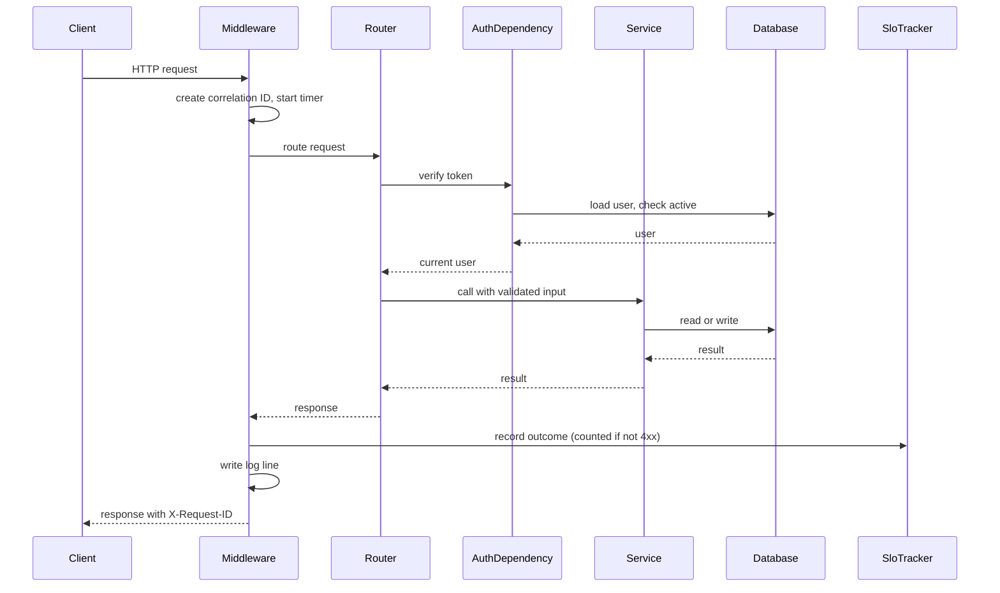

### 8.2 GET /healthz and GET /readyz

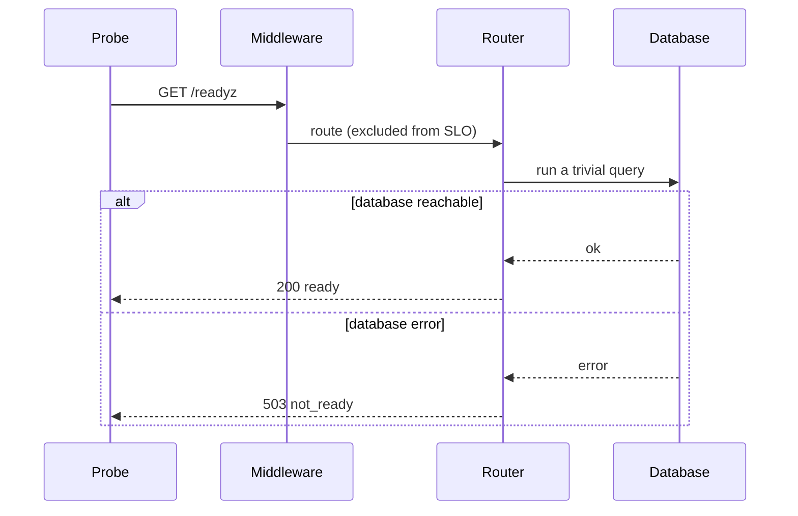

`/healthz` is the same without the database step and always answers 200 while the process runs.

### 8.3 GET /metrics

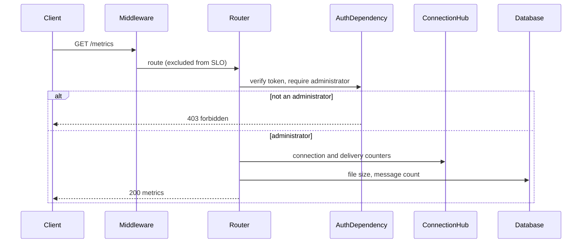

### 8.4 GET /api/v1/slo

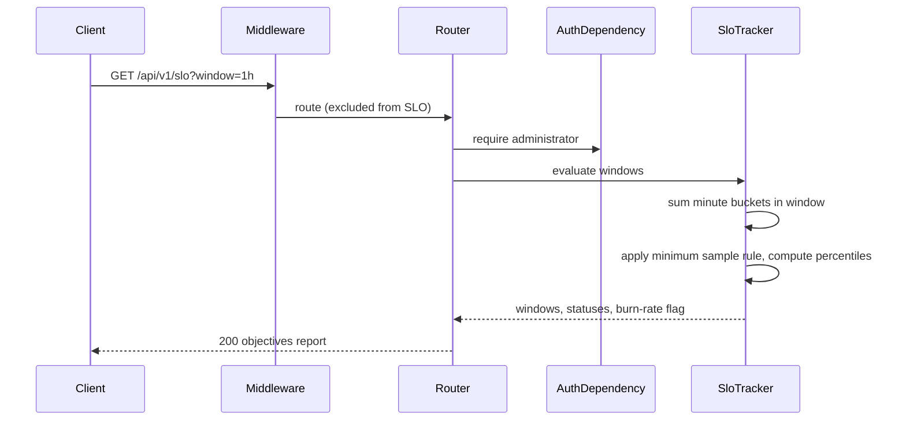

### 8.5 POST /api/v1/auth/dev-login

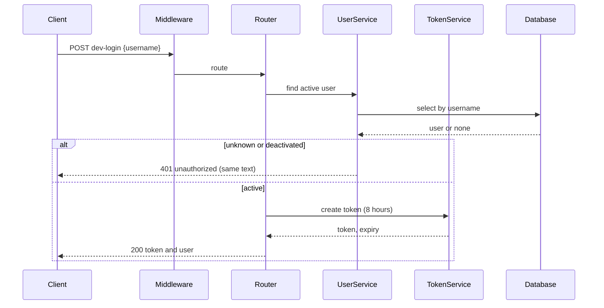

### 8.6 GET /api/v1/me

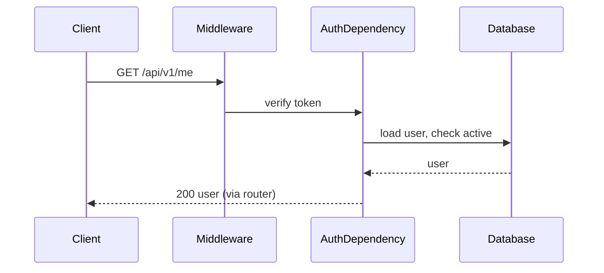

### 8.7 GET /api/v1/users

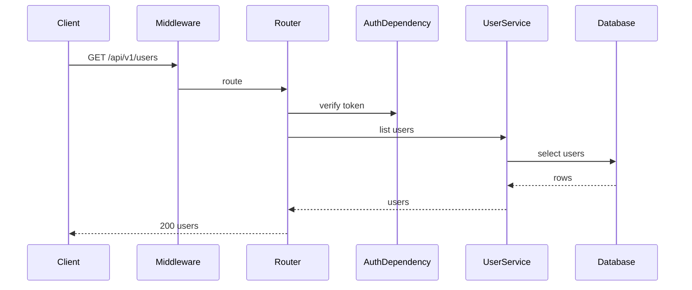

### 8.8 POST /api/v1/users

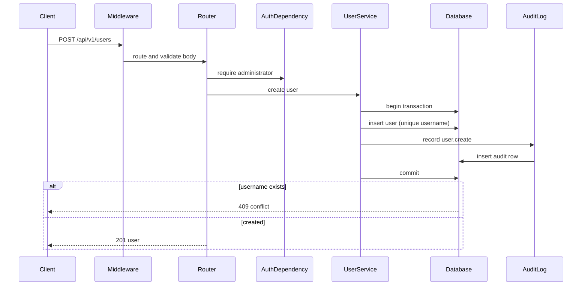

### 8.9 PATCH /api/v1/users/{user_id}

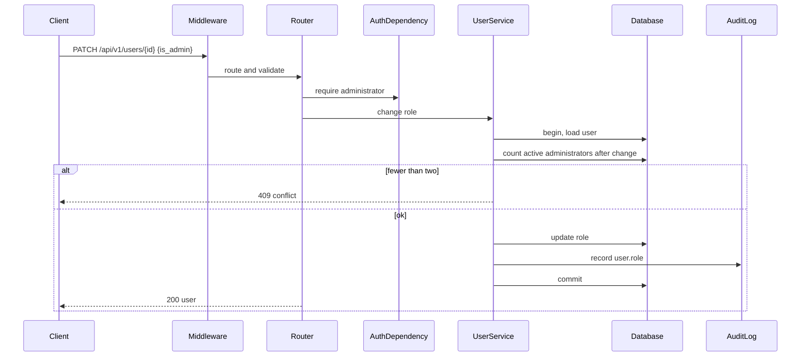

### 8.10 POST /api/v1/users/{user_id}/deactivate

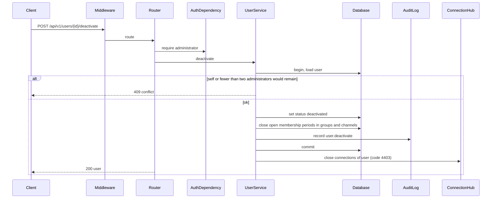

### 8.11 GET /api/v1/conversations

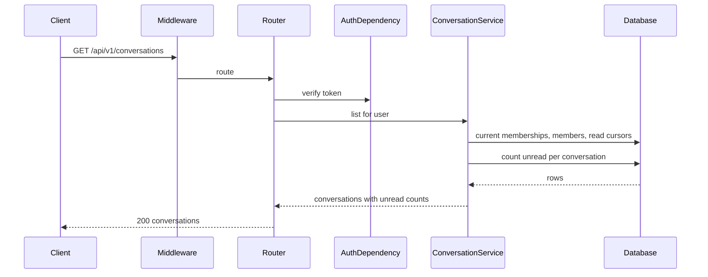

### 8.12 POST /api/v1/conversations

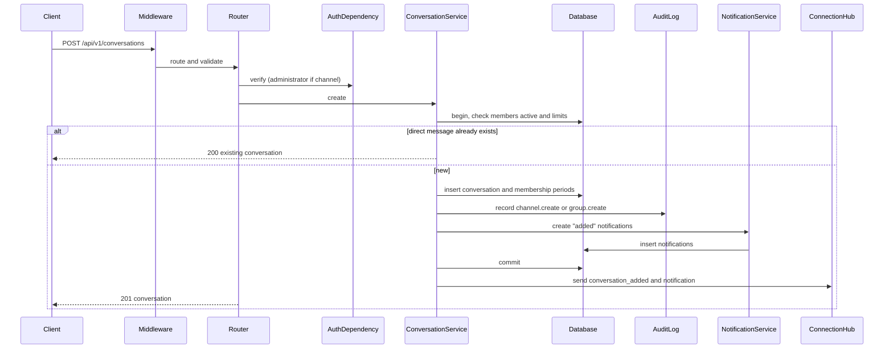

### 8.13 GET /api/v1/conversations/{conversation_id}

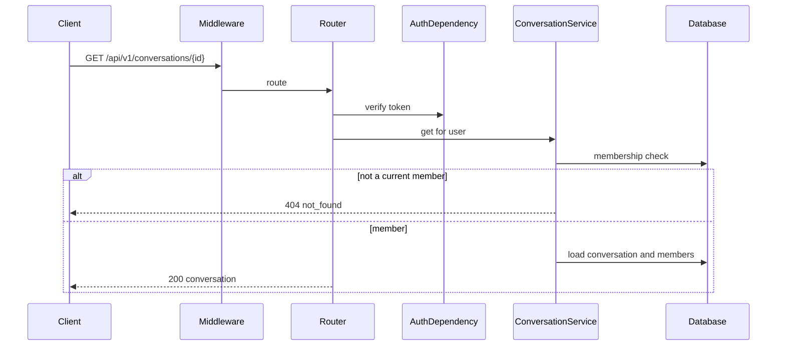

### 8.14 POST /api/v1/conversations/{conversation_id}/members

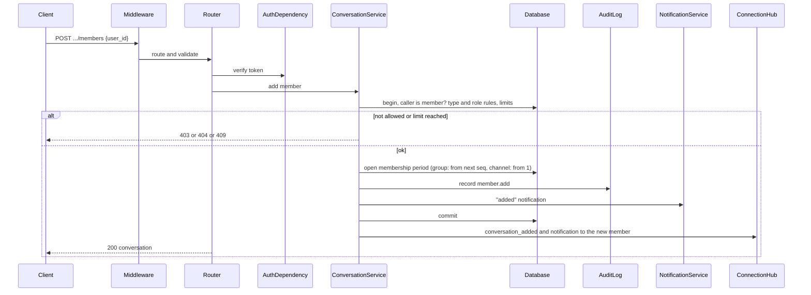

### 8.15 DELETE /api/v1/conversations/{conversation_id}/members/{user_id}

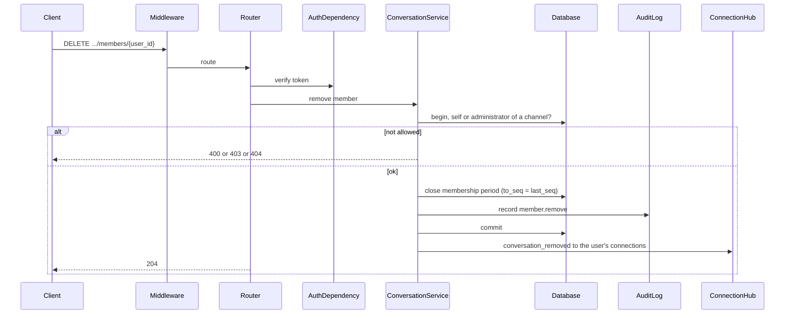

### 8.16 POST /api/v1/conversations/{conversation_id}/read

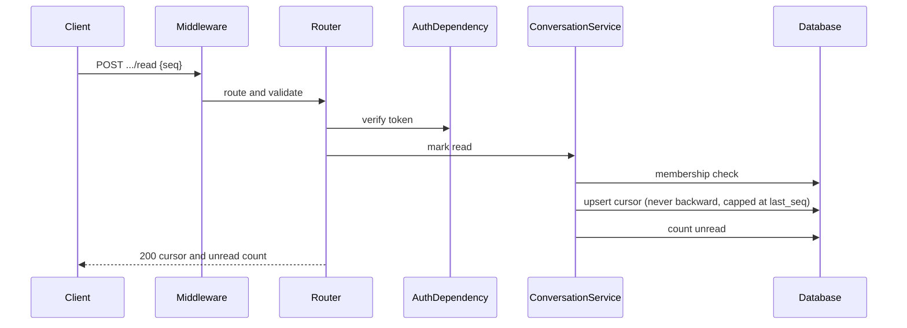

### 8.17 GET /api/v1/conversations/{conversation_id}/messages

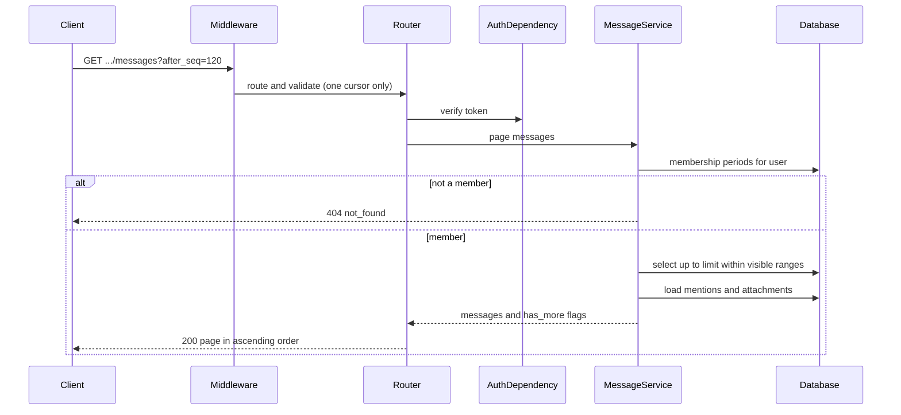

### 8.18 POST /api/v1/conversations/{conversation_id}/messages (send)

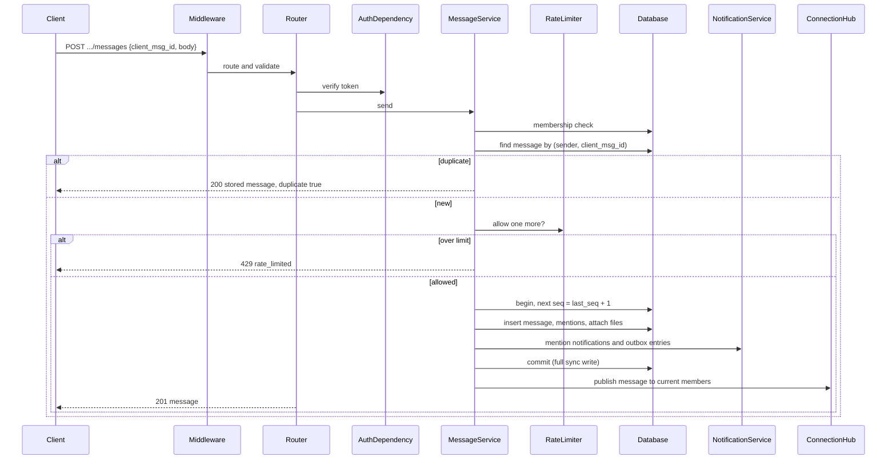

### 8.19 GET /api/v1/messages/{message_id}/thread

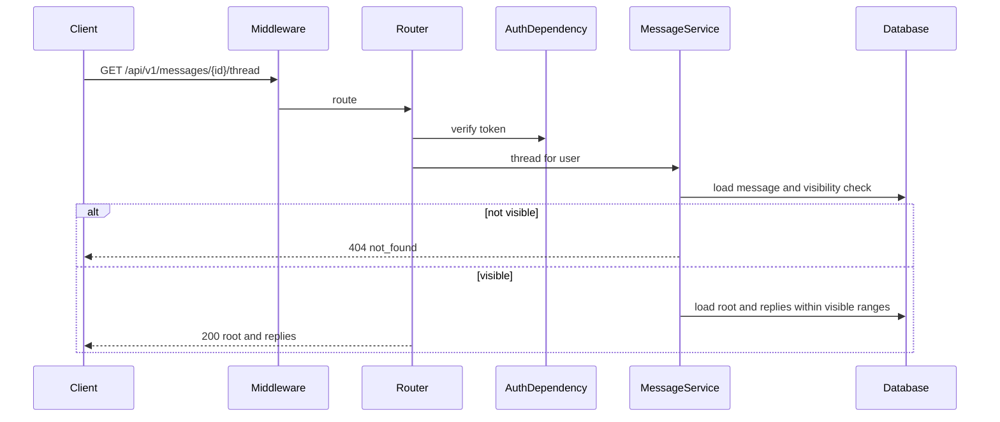

### 8.20 DELETE /api/v1/messages/{message_id}

```mermaid
sequenceDiagram
    participant Client
    participant MW as Middleware
    participant Router
    participant Auth as AuthDependency
    participant Svc as MessageService
    participant Att as AttachmentService
    participant DB as Database
    participant Hub as ConnectionHub
    Client->>MW: DELETE /api/v1/messages/{id}
    MW->>Router: route
    Router->>Auth: verify token
    Router->>Svc: delete
    Svc->>DB: load, visibility, author check
    alt not visible
        Svc-->>Client: 404
    else not author
        Svc-->>Client: 403 forbidden
    else author
        Svc->>DB: begin: body null, deleted_at, delete mentions (index updated by trigger)
        Svc->>Att: mark attachments deleted
        Svc->>DB: commit
        Att->>Att: remove files from disk
        Svc->>Hub: publish message_deleted
        Router-->>Client: 204
    end
```

### 8.21 POST /api/v1/attachments

```mermaid
sequenceDiagram
    participant Client
    participant MW as Middleware
    participant Router
    participant Auth as AuthDependency
    participant Svc as AttachmentService
    participant DB as Database
    participant Disk as Attachment folder
    Client->>MW: POST /api/v1/attachments (multipart)
    MW->>Router: route
    Router->>Auth: verify token
    Router->>Svc: store upload
    Svc->>DB: membership check for conversation
    Svc->>Svc: check type, read up to size limit
    alt too large or wrong type
        Svc-->>Client: 413 or 415
    else ok
        Svc->>Svc: scanner check
        Svc->>Disk: write file under generated name
        Svc->>DB: insert attachment (message null)
        Router-->>Client: 201 attachment
    end
```

### 8.22 GET /api/v1/attachments/{attachment_id}

```mermaid
sequenceDiagram
    participant Client
    participant MW as Middleware
    participant Router
    participant Auth as AuthDependency
    participant Svc as AttachmentService
    participant DB as Database
    participant Disk as Attachment folder
    Client->>MW: GET /api/v1/attachments/{id}
    MW->>Router: route
    Router->>Auth: verify token
    Router->>Svc: open for user
    Svc->>DB: load attachment, check member and message visibility
    alt not allowed, deleted, or rejected
        Svc-->>Client: 404
    else allowed
        Svc->>Disk: read file
        Router-->>Client: 200 bytes (attachment, nosniff)
    end
```

### 8.23 GET /api/v1/search

```mermaid
sequenceDiagram
    participant Client
    participant MW as Middleware
    participant Router
    participant Auth as AuthDependency
    participant Svc as SearchService
    participant DB as Database
    Client->>MW: GET /api/v1/search?q=budget
    MW->>Router: route and validate
    Router->>Auth: verify token
    Router->>Svc: search for user
    Svc->>Svc: turn text into safe quoted terms
    Svc->>DB: full-text match joined to the user's visible ranges
    DB-->>Svc: newest matches, not deleted
    Svc-->>Router: results with excerpts
    Router-->>Client: 200 results
```

### 8.24 GET /api/v1/notifications

```mermaid
sequenceDiagram
    participant Client
    participant MW as Middleware
    participant Router
    participant Auth as AuthDependency
    participant Svc as NotificationService
    participant DB as Database
    Client->>MW: GET /api/v1/notifications
    MW->>Router: route
    Router->>Auth: verify token
    Router->>Svc: list for user
    Svc->>DB: select latest 100, count unread
    Router-->>Client: 200 notifications and unread count
```

### 8.25 POST /api/v1/notifications/{notification_id}/read

```mermaid
sequenceDiagram
    participant Client
    participant MW as Middleware
    participant Router
    participant Auth as AuthDependency
    participant Svc as NotificationService
    participant DB as Database
    Client->>MW: POST .../notifications/{id}/read
    MW->>Router: route
    Router->>Auth: verify token
    Router->>Svc: mark read
    Svc->>DB: update read_at where owner is caller
    alt not the caller's
        Svc-->>Client: 404
    else
        Router-->>Client: 200 notification
    end
```

### 8.26 Real-time flow: connect and resume (catch-up)

```mermaid
sequenceDiagram
    participant Client
    participant WS as WebSocket endpoint
    participant Tok as TokenService
    participant DB as Database
    participant Hub as ConnectionHub
    participant SLO as SloTracker
    Client->>WS: connect /ws?token=...
    WS->>Tok: verify token
    WS->>DB: load user, check active
    alt invalid, expired, or deactivated
        WS-->>Client: close 4401 or 4403
        Note over WS,SLO: token and access refusals are client errors and are not counted
    else ok
        WS->>Hub: register connection, start writer task
        Hub-->>Client: hello {server_time, taken before any reading starts}
        Client->>Client: reload conversation list over HTTP (GET /api/v1/conversations)
        Client->>WS: resume {cursors, since}
        loop each listed conversation
            Hub->>DB: messages after cursor within visible ranges (max 50)
            Hub-->>Client: resume_page {messages, has_more}
        end
        Hub->>DB: IDs deleted since "since" in the user's conversations
        Hub-->>Client: resume_done {server_time, deleted}
        WS->>SLO: record successful request
    end
```

### 8.27 Real-time flow: push a new message and confirm delivery

```mermaid
sequenceDiagram
    participant Sender
    participant Svc as MessageService
    participant DB as Database
    participant Hub as ConnectionHub
    participant Q as Connection queue
    participant Recipient
    participant SLO as SloTracker
    Sender->>Svc: POST message (see 8.18)
    Svc->>DB: commit message (t0 = server receive time)
    Svc->>Hub: publish(message)
    Hub->>DB: current members of the conversation
    loop each open connection of each member
        Hub->>Q: enqueue message frame, remember t0 per recipient connection
        Q-->>Recipient: message frame
        Recipient->>Hub: ack {message_id}
        Hub->>SLO: record latency = now - t0 (recipients other than the sender)
    end
    Note over Hub,SLO: no ack within 10 seconds: record in the slowest bucket
```

### 8.28 Real-time flow: member removed or conversation added

```mermaid
sequenceDiagram
    participant Admin as Caller
    participant Svc as ConversationService
    participant DB as Database
    participant Hub as ConnectionHub
    participant Target as Affected user
    Admin->>Svc: add or remove member
    Svc->>DB: commit membership change
    Svc->>Hub: notify user
    alt added
        Hub-->>Target: conversation_added and notification
    else removed
        Hub-->>Target: conversation_removed
        Note over Hub,Target: later publishes look up current members, so no more events are sent to this user for the conversation
    end
```

### 8.29 Real-time flow: user deactivated while connected

```mermaid
sequenceDiagram
    participant Admin
    participant Svc as UserService
    participant DB as Database
    participant Hub as ConnectionHub
    participant Conn as User's connections
    Admin->>Svc: deactivate user (see 8.10)
    Svc->>DB: commit status and membership changes
    Svc->>Hub: disconnect_user(user)
    Hub-->>Conn: close with code 4403
    Note over Conn: any later request or reconnect fails the active-user check (401)
```

### 8.30 Real-time flow: deletion reaches online and offline users

```mermaid
sequenceDiagram
    participant Author
    participant Svc as MessageService
    participant DB as Database
    participant Hub as ConnectionHub
    participant Online as Online member
    participant Offline as Offline member
    Author->>Svc: DELETE message (see 8.20)
    Svc->>DB: commit tombstone
    Svc->>Hub: publish message_deleted
    Hub-->>Online: message_deleted (screen updates at once)
    Note over Offline: no connection, nothing sent
    Offline->>Hub: later: resume {cursors, since}
    Hub->>DB: IDs deleted after "since"
    Hub-->>Offline: resume_done {deleted: [message_id]}
    Note over Offline: the page removes the message
```

### 8.31 Real-time flow: slow client, queue overflow, and reconnect

```mermaid
sequenceDiagram
    participant Hub as ConnectionHub
    participant Q as Connection queue (max 1000)
    participant Client
    Hub->>Q: enqueue event
    alt queue is full
        Hub->>Client: close with code 4408
        Client->>Client: wait (1 s doubling to 30 s)
        Client->>Hub: reconnect and send resume (flow 8.26)
    else space available
        Q-->>Client: send frame
    end
```

### 8.32 Real-time flow: token expiry while connected

```mermaid
sequenceDiagram
    participant Sweep as Hub sweeper (every 30 s)
    participant Hub as ConnectionHub
    participant Client
    Sweep->>Hub: find connections past token expiry
    Hub-->>Client: close with code 4401
    Client->>Client: show "session expired", keep unsent text
```

## 9. Meeting the Fundamentals

### 9.1 Customer-centric SLOs

These are the objectives from the requirements (SLO-01 to SLO-05). Windows: **1 hour**, **24 hours**, **28 days rolling**.

#### How the design measures them

| What | How | Trace |
| --- | --- | --- |
| Success Rate | The middleware reports one outcome per customer API call. A call fails when the status is 5xx, when it raises an unhandled error, or when it takes more than 10 seconds. A 4xx is a client error and is not counted. A WebSocket connection that is refused for a service reason, or a resume that errors, also counts as failed. Health, metrics, objectives, and static files are not counted. | SLO-01, DD-14 |
| Latency | For each message delivered to a recipient with an open connection, the hub records the time between the server receiving the message and the recipient's confirmation. After 10 seconds with no confirmation, the delivery is recorded in the slowest bucket. The sender's own devices are not counted. | SLO-02, DD-13 |
| Windows | Counts are kept in one-minute buckets, saved to the database, and summed for the last 60 minutes, the last 24 hours, and the last 28 days. They survive restarts. | DD-15 |
| Percentiles | Latency is counted in fixed buckets whose edges include 200, 400, 700, 1000, and 2000 ms. A percentile is the upper edge of the bucket where the running count reaches that share. This never understates the latency. | DD-13 |
| Too few samples | A window with fewer than 30 requests, or fewer than 30 latency samples (100 for P99), reports "insufficient data". | SLO-05, DD-16 |
| Warning | If the 1-hour Success Rate is below 99.9 percent while the 24-hour value is within target, the report sets `burn_rate_warning`. | SLO-04 |

#### Success Rate SLO: 99.9 percent

| Window | What 99.9 percent allows | How the design supports it |
| --- | --- | --- |
| 1 hour | 1 failed request per 1,000. At about 100 requests an hour (A-28), a single failure is a breach, so this window warns and does not decide compliance. | Failure handling in section 10, the warning rule, and the minimum sample rule keep the window useful and not noisy. |
| 24 hours | About 86 seconds of full outage if traffic were steady, or about 2 failures per 2,000 requests. | Atomic writes, idempotent retry, and a bounded catch-up keep a restart or a network drop from becoming failed requests. |
| 28 days | About 40 minutes of full outage across the window. This is the compliance window and the error budget. | Deployments that restart one process are the main risk. See the shortcut R-01 and the production mitigation: at least two instances, rolling deploys, and zone redundancy (A-26, NFR-01). |

Design features that protect the Success Rate:

- **No partial writes:** every change is one transaction (DD-03, DD-05).
- **Safe retry:** a client retry returns the stored message, so a transient failure does not become a second failure or a duplicate (DD-04).
- **Bounded work per request:** pages of 50, upload limit of 25 MB, message length of 4,000, 10-second request limit, and the 30-per-minute rate limit keep one request from starving others (DD-23).
- **Isolated slow clients:** per-connection queues keep one slow client from slowing the rest (DD-01, pattern table).
- **Blind spot, named:** a service that is down records nothing, so the in-process measure cannot see a full outage. Production adds an external availability probe and client-side telemetry (R-07).

#### Latency SLO

The measured span is server receive to recipient confirmation (SLO-02). This table shows the budget design for each percentile. The values are a design allocation to be confirmed by load testing (test T-60 in [chatapp.testspecs.md](./chatapp.testspecs.md)). On one machine over the local network, the network part is close to zero, so a local test only proves the service part.

| Percentile | Target | Service part (validate, authorize, commit, enqueue) | Delivery part (send, client handling, confirmation back) | Total design budget | Margin |
| --- | --- | --- | --- | --- | --- |
| P50 | 200 ms | 15 ms | 80 ms | 95 ms | 105 ms |
| P75 | 400 ms | 30 ms | 150 ms | 180 ms | 220 ms |
| P90 | 700 ms | 60 ms | 300 ms | 360 ms | 340 ms |
| P95 | 1,000 ms | 100 ms | 450 ms | 550 ms | 450 ms |
| P99 | 2,000 ms | 250 ms | 900 ms | 1,150 ms | 850 ms |

Assumed client network round trip: about 60 ms typical (P50) and up to 600 ms at P99, for corporate and home networks. This is an assumption, not a measurement, and it should be replaced by measured values from client telemetry after launch.

How the design keeps the service part small:

- One short transaction with an indexed insert and a single-row sequence update. No network hop to a database.
- The membership check and the sequence assignment are single indexed lookups.
- Fan-out only places an item on a queue. The writer tasks send in parallel, so recipients do not wait for each other.
- Heavy work (attachment scanning, notifications to an outbox, search index) is either done before the send (uploads) or inside the same short transaction (index by trigger), so nothing slow sits in the delivery path.
- The tail (P99) is driven by disk sync time and client networks. Full synchronous writes cost a few milliseconds on a laptop disk, so the 250 ms allocation has wide margin. In production, zone-redundant database commits add time, which is why the service part grows for production and why the margin is kept large.

| Window | How the design supports it |
| --- | --- |
| 1 hour | Per-percentile status with the minimum sample rule. A quiet hour reports "insufficient data" instead of a noisy value. |
| 24 hours | Detects daily patterns such as a slow period after a deployment. |
| 28 days | Defines compliance. The percentile counts are summed from saved buckets, so a restart does not reset it. |

### 9.2 Quality

- Every core promise (order, no duplicates, catch-up, permissions, deletion) has automated tests (NFR-06, A-14).
- One server-assigned order and one idempotency rule remove the most common chat defects (DD-03, DD-04).
- Strict input validation at the transport layer and rules in one service layer.

### 9.3 Capacity

- Sized for 10 users, 2,000 messages a day, 20 attachments a day, 10 connections (A-28). One process and one SQLite file handle this with large headroom. The requirement of 10 times headroom (NFR-04) is met on a single instance by design: paging, bounded queues, and indexes.
- Storage growth is visible: the metrics page reports database size, attachment bytes, and message count (OPS-01).
- Unbounded history is not assumed: retention is configurable (DD-18).
- Growth beyond one process needs the production changes in section 11.

### 9.4 Availability

- The target is 99.9 percent a month (A-26). A single instance cannot meet it through deployments. The lab design is built so the production design can: stateless services other than the hub, a database that is the only source of truth, and clients that reconnect and resume on their own (flow 8.26).
- The production plan: at least two instances behind Azure Front Door or Application Gateway, rolling deployment, zone-redundant database, and an external availability probe.

### 9.5 Resiliency

- An acknowledged message is on disk (full synchronous write, DD-05), so a crash or restart loses nothing acknowledged (NFR-02).
- The client keeps unsent messages and retries with the same ID.
- Catch-up (resume) rebuilds any client's view from the database after any outage, in pages (DD-23).
- A backup command copies the database safely while running (SQLite backup interface). The recovery time of 4 hours and quarterly restore tests are met by procedure in the lab and by managed backups in production (NFR-03).

### 9.6 Security

- Membership is checked in the service layer on every request and on every real-time connection, and a non-member and a missing item look the same (DD-06, DD-08).
- The signed token has an expiry of 8 hours, and the active-user check happens on every request, so deactivation is immediate (DD-07, SEC-09).
- No endpoint returns message content to an administrator by role (DD-09, SEC-04).
- Administrative actions are audited in the same transaction (DD-19).
- Output is escaped before markdown rules run, with a strict content security policy, `nosniff`, `no-referrer`, `frame-ancestors 'none'`, and attachment downloads as attachments only (DD-10).
- Uploads are limited by size and type, stored under generated names, and pass through a scanner interface (DD-22).
- Search queries are turned into quoted words, so users cannot inject search syntax.
- The lab gaps (no TLS, no Entra ID, no encryption at rest, scanner stub) are listed in section 11.

### 9.7 Privacy

- Deleting a message empties it, removes its files, mentions, and index entry in one transaction, so no copy the service controls survives (DD-11, PRV-01, PRV-02).
- Offline devices drop deleted messages on reconnect (DD-12).
- Notifications and the email outbox hold no message text (DD-24, PRV-04).
- Logs hold no message text (DD-21, PRV-03).
- Retention is configurable, and no logic assumes "keep forever" (DD-18).
- Compliance rules are still an open item (A-18), and the data is classified as Confidential for design purposes (SEC-07).

### 9.8 Accessibility

- The client follows WCAG 2.1 AA practice: semantic landmarks, labeled controls, visible focus, keyboard-only use, a skip link, high contrast, and no reliance on color (ACC-01, funcspecs section 9).
- New messages and errors are announced through polite live regions without taking focus (ACC-02).
- Threads, notifications, search results, and mentions are labeled regions with managed focus (ACC-03).
- Rendering is by safe DOM construction, so assistive technology reads real elements.
- A formal audit and testing with screen readers are still needed and are not done in the lab (R-14).

### 9.9 Supportability

- Every response has a correlation ID that matches the log line, and the user sees it in the error text (OPS-05).
- Health, readiness, metrics, and the objectives report give operators a view without access to content (OPS-01, SLO-03).
- Configuration comes from the environment, so there is one build for all environments (DD-17).
- The README holds the runbook for common failures (OPS-03). Named ownership and on-call remain an open item (A-32).

## 10. Cross-cutting concerns

### Error handling

- All errors use one shape: `{"error": {"code", "message", "request_id"}}` (DD-20).
- Application errors carry a stable code (`unauthorized`, `forbidden`, `not_found`, `validation_error`, `conflict`, `conversation_closed`, `payload_too_large`, `unsupported_media_type`, `rate_limited`, `internal_error`) and a plain message that is safe to show.
- Validation errors from the transport layer become 400 `validation_error` with the field named.
- Unexpected errors are caught by the middleware, logged with the stack trace and correlation ID, counted as failed requests, and answered with a generic 500. Internal details are never returned.
- The database layer rolls back on any exception, so no partial change is kept.
- Real-time errors close the connection with a code the client understands (4401 session, 4403 access removed, 4408 queue full). The client then acts as described in the functional specs.
- The client retries sends with the same ID and shows status (FR-44).

### Observability

- **Logs:** one JSON line per request with time, level, correlation ID, method, route, status, duration in milliseconds, and user ID. Real-time events log connect, disconnect, and close codes. No bodies, no message text, no file names (DD-21).
- **Metrics:** request counts by status, open connections, deliveries confirmed and timed out, database size, attachment bytes, and message count (`/metrics`).
- **Objectives:** the SLO tracker and `/api/v1/slo`.
- **Correlation:** `X-Request-ID` is accepted from the caller if it is well formed, otherwise created, and is in the response, the log, and the error body.
- **Production:** the same events go to OpenTelemetry and Azure Monitor (section 11).

### Configuration

All settings are environment variables with a `CHATAPP_` prefix and safe defaults (DD-17).

| Setting | Default | Meaning |
| --- | --- | --- |
| `CHATAPP_DB_PATH` | `data/chatapp.db` | Database file |
| `CHATAPP_ATTACHMENT_DIR` | `data/attachments` | Attachment folder |
| `CHATAPP_SECRET_KEY` | generated and saved in `data/secret.key` | Token signing key |
| `CHATAPP_DEV_AUTH` | `true` | Enables the development sign-in (lab only) |
| `CHATAPP_ADMIN_USERNAMES` | `admin1,admin2` | Administrators created at first start (A-30) |
| `CHATAPP_SEED_USERS` | `alice,bob,carol` | Sample members created at first start (lab only) |
| `CHATAPP_SESSION_HOURS` | `8` | Session life |
| `CHATAPP_RATE_LIMIT_PER_MIN` | `30` | Messages per user per minute |
| `CHATAPP_MAX_UPLOAD_MB` | `25` | Upload limit |
| `CHATAPP_REQUEST_TIMEOUT_S` | `10` | Failure threshold for the Success Rate |
| `CHATAPP_RETENTION_DAYS` | `0` (off) | Message content older than this is removed |
| `CHATAPP_LOG_LEVEL` | `INFO` | Log level |

## 11. Architectural risks and lab shortcuts

### 11.1 Lab shortcuts (not for production Microsoft software)

Every item below was chosen for the lab constraints of running locally with no setup. Each names the production-appropriate alternative and how to reduce the risk in production.

| ID | Lab choice | Risk it carries | Production alternative | Mitigation in production | Trace |
| --- | --- | --- | --- | --- | --- |
| R-01 | One process, one machine, no replication | Any restart, crash, or machine loss makes the service unavailable. The 99.9 percent target cannot be met. | At least two instances in Azure App Service or Container Apps across availability zones, behind Azure Front Door or Application Gateway | Rolling deployment, health-probe based routing, autoscale rules, and an external availability test | A-26, NFR-01, SLO-01 |
| R-02 | SQLite file on local disk (not a durable, replicated store) | Disk loss loses all data. One writer at a time. No point-in-time recovery. Not shareable by several instances. | Azure SQL Database or Azure Database for PostgreSQL Flexible Server, zone-redundant with geo-replication and point-in-time restore | Synchronous replicas for zero data loss on acknowledged messages, backups retained to cover the 35-day delete rule, quarterly restore tests | A-27, NFR-02, NFR-03 |
| R-03 | In-process connection hub | Works for one instance only. A second instance would not deliver to users connected to the first. Restart drops all connections at once. | Azure Web PubSub or Azure SignalR Service | The managed service holds connections, so deployments do not drop them. Clients still resume by cursor. Add jittered reconnect to avoid a thundering herd. | A-10, NFR-01 |
| R-04 | Development sign-in with a self-issued token, no Entra ID, no MFA | Anyone who knows a user name can sign in as that user. This is acceptable only on a developer machine. | Microsoft Entra ID with OpenID Connect (MSAL), token validation against the Entra signing keys, conditional access with MFA | Disable `CHATAPP_DEV_AUTH` in every non-development environment and fail startup if it is on. Map the team's Entra group to membership. Short-lived access tokens with refresh. | A-03, FR-01, SEC-06 |
| R-05 | Plain HTTP and WebSocket on localhost | Traffic is readable on the network. | TLS 1.2 or later, ended at Front Door or App Service, with HSTS | Enforce HTTPS only, redirect HTTP, and use `wss` for real-time. Use managed certificates. | A-22, SEC-01 |
| R-06 | No encryption at rest. Files and database are plain on disk. | Disk theft or access exposes confidential chats. | Azure storage and database service encryption with customer-managed keys in Azure Key Vault | Rotate keys, restrict key access with managed identities, encrypt backups | A-22, SEC-02 |
| R-07 | The SLO tracker lives in the service and writes to the same database | A fully down service records nothing, so an outage is invisible to the measurement. The tracker shares fate with the app. | OpenTelemetry to Azure Monitor and Application Insights, plus availability tests and client-side telemetry. SLO queries in Log Analytics (KQL) | Alert rules on multi-window burn rate, an external probe from several regions, and a dashboard owned by the on-call team | A-33, SLO-01, OPS-02 |
| R-08 | Attachments on local disk, scanner is a stub that accepts every file | Malware can be stored and served to team members. Files are lost with the disk. | Azure Blob Storage with Microsoft Defender for Storage malware scanning, private endpoints, and time-limited access tokens | Hold a file as `pending` until the scan result arrives and never serve it before. Quarantine rejected files. Apply lifecycle rules matching retention. | A-23, FR-24, SEC-08 |
| R-09 | Full-text search with SQLite FTS5 | Does not scale out. Rebuilding is manual. | Azure AI Search or database full-text search with security trimming on membership | Filter every query by the user's visible ranges server-side. Delete index entries in the same flow as message deletion and verify with a test. | A-07, A-20, FR-25 |
| R-10 | Rate limiter in process memory | Resets on restart. Does not work across instances. | Shared limiter in Azure Cache for Redis, or limits at Azure API Management or Front Door | Keep per-user limits server-side. Add per-IP limits at the edge. | A-31, FR-46 |
| R-11 | Signing key stored in a local file | The key can be read from disk. | Azure Key Vault with managed identity (unnecessary once Entra ID validates tokens) | No secrets in configuration or source. Rotate keys. | A-22 |
| R-12 | Token passed in the WebSocket URL query | URLs may be logged by proxies and servers, which would expose a token. | Authenticate with a short-lived, single-use connection ticket obtained over an authenticated call, or use the managed service's client access tokens | Strip query strings from logs. Make tickets expire in seconds. | A-22, SEC-03 |
| R-13 | Email and push are an outbox that is never sent | Mentions are not delivered to offline users outside the app. | Azure Communication Services Email, Azure Notification Hubs for push | Keep the no-message-text rule in templates. Honor user preferences and rate-limit. | A-07, A-20, FR-26 |
| R-14 | No formal accessibility audit | Hidden barriers may remain. | Accessibility Insights automated checks in the build, manual keyboard and screen reader testing, an accessibility review before launch | Make the audit a launch gate. Record the team's needs (open item). | A-24, ACC-01 to ACC-03 |
| R-15 | Audit log in the same mutable database | An administrator with database access could change it. | Append-only audit stream to Log Analytics or immutable blob storage | Write-once retention. Alert on unusual administrative activity. | A-22, SEC-05 |
| R-16 | No backups or disaster recovery beyond a manual command | Total loss on disk failure or region loss. The 4-hour recovery objective cannot be met. | Managed automated backups and cross-region replication | Quarterly restore drill, and documented regional failover | A-27, NFR-03 |
| R-17 | Database calls run on the event loop | A slow query would pause all connections at higher load. Fine at 10 users. | Async database driver with a connection pool, and query timeouts | Load tests at 10 times expected load, and query plan review | A-28, NFR-04 |
| R-18 | Administrators and sample users created from environment settings | A mistaken setting could leave no administrator, or create sample users in production. | Provision users and administrators from Entra ID groups | Remove seeding in production builds. Verify two administrators at startup. | A-30, FR-03 |
| R-19 | No automated deployment, no environment separation in the lab | Manual deployment is error-prone. | Infrastructure as code (Bicep) and a deployment pipeline with separate development, test, and production | Never copy production data to lower environments | A-25, A-32, NFR-08, OPS-04 |
| R-20 | Single region, no web application firewall | Regional failure and common web attacks are not covered. | Azure Front Door with WAF, and a second region as needed | Rate limits and managed rule sets at the edge | A-26, A-22 |

### 11.2 The built-in assistant (added at the owner's request)

The assistant ("Copilot") is built into the service. See requirements section 10 (ASST-01 to ASST-09).

| Item | Decision |
| --- | --- |
| Component | `CopilotService` (in `app/copilot.py`). **Responsibilities:** decide when to answer, build the answer, post it as the assistant account, join conversations, give each person a private chat. **Collaborators:** MessageService, ConversationService, SearchService, ConnectionHub, SloTracker, RealtimeData. |
| Identity | A user row with `is_bot = 1`. It cannot sign in or be deactivated, has no notifications or email outbox, and is not counted toward member limits. |
| Trigger | After a message is stored and published, `MessageService.send` calls the assistant. The reply is scheduled on the event loop after a short delay, so it does not add to the sender's request time or to the delivery latency of the sender's message (ASST-09). |
| Privacy boundary | Replies in a group draw only on that conversation and only on what the asker may see. Cross-conversation answers (history, details, mentions, unread, search everywhere) are produced only in the person's private chat and only while their switch is on (ASST-05). |
| Live data | `RealtimeData`: time zones offline (tzdata), weather and unknown-place time through Open-Meteo. The call runs on a worker thread. Only a place name is sent (ASST-07). Switch: `CHATAPP_COPILOT_WEB`. |
| Replaceable part | `AiBackend` (`app/ai.py`) is the model connection: Ollama on this computer by default, or Azure OpenAI by configuration. Exact commands stay in code. If the model fails, `answer()` falls back to the built-in reply (risk R-21). |

| ID | Risk (lab choice) | Production alternative and mitigation |
| --- | --- | --- |
| R-21 | The model on this computer is small and slower than a hosted model, and Copilot's answers can be wrong. A remote model would send chat text to another service. | Use an approved model in the organization's tenant (Azure OpenAI) after a data-protection review (A-18), with content filtering and no training on chat data. Keep the privacy boundary: only what the asker may see goes into the prompt, and other people's messages are labelled untrusted. |
| R-22 | Live lookups call a free public service with no agreement. | An approved weather and time source behind an outbound proxy, or switch the lookups off. Only the place name is sent. |
| R-23 | The assistant is a member of every group, so it can technically read them, and replies to everything by default. | Per-conversation opt-in by members, a visible indicator, a retention rule for anything it stores, and team consent before launch. |

### 11.3 Design risks that remain in any environment

| ID | Risk | Mitigation | Trace |
| --- | --- | --- | --- |
| D-01 | Message order depends on one atomic sequence per conversation. If a future change allowed two writers without a database-level guarantee, order could break. | Keep sequence assignment inside the database transaction. A test sends concurrent messages and checks gap-free, unique numbers (T-12). | DD-03, FR-41 |
| D-02 | Many clients reconnecting together after a deployment could overload catch-up. | Page size of 50, jittered backoff, and a per-connection resume limit. Load-test the reconnect case. | DD-23, NFR-07 |
| D-03 | Deleting content from backups cannot be immediate. | State the backup expiry (35 days) to users and keep backups encrypted and access-restricted. | A-17, FR-28 |
| D-04 | Retention is a placeholder. A late compliance answer could change the data model (for example legal hold). | Keep retention a setting and the deletion path single. Raise the open question early. | A-16, A-18 |
| D-05 | Markdown rendering is client code. A flaw there could allow script injection. | Escape first, allow only a small set of rules, a strict content security policy, and tests with hostile inputs (T-40). | DD-10, FR-21 |
| D-06 | The latency measure depends on client confirmations. A client that does not confirm looks slow. | Count it in the slowest bucket on purpose, and investigate through correlation IDs. | DD-13, SLO-02 |
| D-07 | The proposed numbers (limits, targets, budgets) are unconfirmed. | They are in one settings file and in the assumptions list for confirmation. | A-26 to A-31 |
